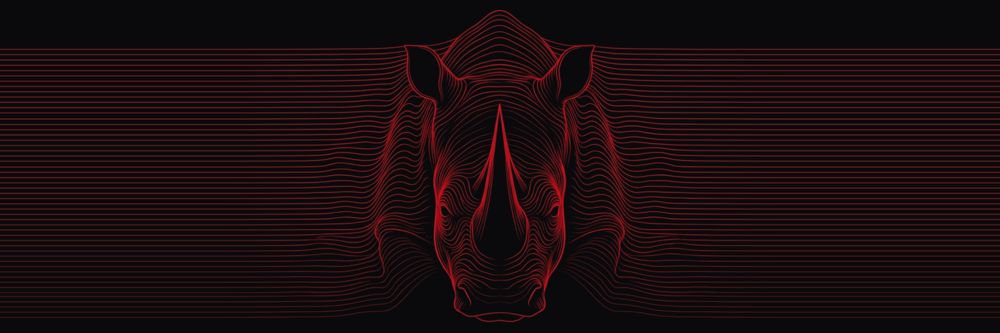

<p align="center">
 
</p>
### Furkan Utku Gerçik // `@Rhinofug`
**Founding Architect of [Xulab Collective](https://github.com/xulab-collective). Open-source audio and post-production engineering.**

```text
ROLE       Founding Architect @ Xulab Collective
FOCUS      Audio Post-Production · DSP & AI Workflows · Open-Source Pipeline Engineering // AAF · OTIO · MIDI · MCP
COLLECTIVE https://xulab-collective.github.io  |  https://github.com/xulab-collective
WEB        https://rhinofug.github.io  |  X: https://x.com/Rhinofug
```

---
### Active Foundry & Releases

- **[Xulab Collective // `github.com/xulab-collective`](https://github.com/xulab-collective)** : *Media and post-production technology production collective equipped with AI, technology, and open source under `Strict AGPLv3` and `Dual-License`.*
  - **[The Xulab Manifesto // TR & EN](https://github.com/xulab-collective/.github/blob/main/MANIFESTO.md)**
  - **[Protocol & Rulebook // `v1.0`](https://github.com/xulab-collective/.github/blob/main/PROTOCOL.md)**
  - **[Commercial Policies & Slicing Pie Pool // `v1.0`](https://github.com/xulab-collective/.github/blob/main/COMMERCIAL_POLICY.md)**
  - **[Master Plan & Roadmap](https://github.com/xulab-collective/.github/blob/main/ROADMAP.md)**
- **[VCut2DAW v1.0 // `github.com/xulab-collective/VCut2DAW`](https://github.com/xulab-collective/VCut2DAW)** : *100% Local Video Scene Cut Detection and CMX3600 EDL to Pro Tools Dummy AAF and 960 PPQ / 120 BPM Frame-Accurate MIDI Marker Pipeline under `AGPLv3`.*
